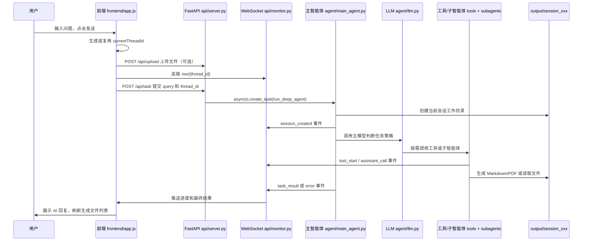
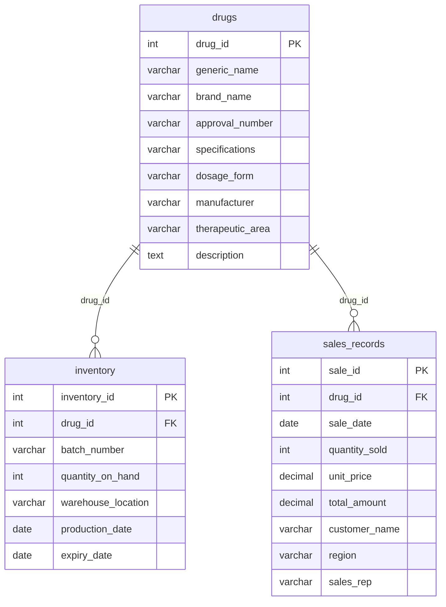

# DeepSearch Pro 项目学习指南

> 适合对象：想从零理解本项目整体架构、请求链路、智能体编排、工具调用、前后端交互和常见问题排查的学习者。  
> 建议读法：先跑通项目，再按“一次请求链路”倒推源码，最后按练习任务做小改动。

## 1. 项目一句话介绍

DeepSearch Pro 是一个“医药业务智能助手”项目。用户在网页中输入问题或上传文件，后端会启动一个 DeepAgents 主智能体，由主智能体根据问题选择工具或子智能体完成任务，例如：

- 查询企业内部 MySQL 药品、库存、销售数据。
- 调用 Tavily 搜索公开互联网信息。
- 调用 RAGFlow 检索企业知识库。
- 读取用户上传的 txt、md、docx、pdf、xlsx 文件。
- 生成 Markdown 报告。
- 将 Markdown 转成 PDF。

项目的核心不是单纯聊天，而是“主智能体 + 多工具 + 多子智能体 + WebSocket 进度反馈”的综合应用。

## 2. 技术栈总览

| 层级 | 技术 | 作用 |
| --- | --- | --- |
| 前端 | 原生 HTML/CSS/JavaScript | 聊天界面、文件上传、文件下载、WebSocket 进度展示 |
| 后端 Web | FastAPI + Uvicorn | 提供 HTTP API、WebSocket、静态前端页面 |
| 智能体框架 | deepagents + langgraph | 创建主智能体和子智能体，支持任务编排 |
| LLM 接入 | langchain-openai + OpenAI-compatible API | 接入 DashScope/通义千问等兼容 OpenAI 协议的模型服务 |
| 数据库 | MySQL + mysql-connector-python | 查询药品、库存、销售记录等结构化业务数据 |
| 搜索 | Tavily | 公开互联网搜索 |
| 知识库 | RAGFlow SDK | 内部知识库问答 |
| 文档处理 | python-docx、pypdf、pandas、openpyxl、markdown、pywin32 | 文件读取、Markdown 生成、PDF 转换 |
| 配置 | python-dotenv + `.env` | 管理 API Key、模型、数据库连接等配置 |

## 3. 项目目录结构

```text
deep_search_pro/
|-- agent/
|   |-- llm.py
|   |-- main_agent.py
|   |-- prompts.py
|   `-- subagents/
|       |-- database_query_agent.py
|       |-- knowledge_base_agent.py
|       `-- network_search_agent.py
|-- api/
|   |-- context.py
|   |-- monitor.py
|   |-- server.py
|   `-- __init__.py
|-- frontend/
|   |-- index.html
|   |-- style.css
|   `-- app.js
|-- prompt/
|   `-- prompts.yml
|-- rawflow/
|   |-- chat_assistant_demo.py
|   |-- knowledge_demo.py
|   `-- rag_config.py
|-- tools/
|   |-- db_tools.py
|   |-- markdown_tools.py
|   |-- pdf_tools.py
|   |-- ragflaw_tools.py
|   |-- tavily_tool.py
|   `-- upload_file_read_tool.py
|-- utils/
|   |-- init_database.py
|   |-- path_utils.py
|   `-- word_converter.py
|-- output/
|-- updated/
|-- requirements.txt
|-- 数据库脚本.txt
|-- 项目步骤
`-- .env
```

### 各目录职责

`frontend/` 是浏览器界面。它负责展示聊天消息、发送请求、建立 WebSocket、上传文件、下载生成文件。

`api/` 是 FastAPI 服务层。它负责接收前端请求、启动智能体任务、管理 WebSocket 连接、管理上传和下载。

`agent/` 是智能体核心。它负责初始化模型、加载提示词、创建主智能体、挂载工具和子智能体。

`tools/` 是智能体可以调用的工具集合。每个 `@tool` 函数都会暴露给 LangChain/DeepAgents，让模型可以按需调用。

`utils/` 是底层工具函数，例如路径安全解析、Markdown 转 PDF、数据库初始化。

`prompt/` 放提示词配置。主智能体和子智能体的角色、边界、工具使用规则都在这里定义。

`rawflow/` 放 RAGFlow 原始调用示例和配置加载逻辑。

`output/` 放每次任务生成的文件。每个会话会创建一个 `output/session_xxx/` 目录。

`updated/` 放用户上传的文件。每个会话会创建一个 `updated/session_xxx/` 目录。

## 4. 启动与运行

### 4.1 安装依赖

```bash
pip install -r requirements.txt
```

如果使用 PDF 转换功能，在 Windows 上还需要：

- 安装 Microsoft Word。
- 安装 `pywin32`。
- Python 进程需要能调用 Word COM。

### 4.2 配置 `.env`

项目依赖 `.env` 中的配置。关键配置包括：

```env
OPENAI_BASE_URL=https://dashscope.aliyuncs.com/compatible-mode/v1
OPENAI_API_KEY=你的模型服务APIKey
LLM_MODEL=qwen3-32b

TAVILY_API_KEY=你的TavilyKey

RAGFLOW_API_URL=你的RAGFlow地址
RAGFLOW_API_KEY=你的RAGFlowKey

MYSQL_HOST=localhost
MYSQL_PORT=3306
MYSQL_USER=root
MYSQL_PASSWORD=你的密码
MYSQL_DATABASE=pharma_db
```

说明：

- `OPENAI_BASE_URL` 是 OpenAI-compatible 模型服务地址。
- `OPENAI_API_KEY` 是模型服务密钥。
- `LLM_MODEL` 是优先使用的模型名。如果不配置，代码会按 `LLM_QWEN3`、`LLM_QWEN_MAX` 的顺序查找。
- 当前代码对 `qwen3` 模型会自动添加 `enable_thinking=false`，用于兼容非流式调用。

### 4.3 初始化数据库

项目自带 `数据库脚本.txt`，用于创建 `pharma_db`，包含三张核心表：

| 表名 | 作用 |
| --- | --- |
| `drugs` | 药品基础信息，例如通用名、商品名、批准文号、规格、剂型、厂家、治疗领域 |
| `inventory` | 库存信息，例如批号、库存数量、仓库位置、生产日期、有效期 |
| `sales_records` | 销售记录，例如销售日期、销售数量、单价、客户、区域、销售代表 |

初始化脚本入口：

```bash
python utils/init_database.py
```

注意：该脚本会连接 MySQL 并执行 SQL 文件。运行前要确保 MySQL 服务已启动，`.env` 中数据库账号有建库建表权限。

### 4.4 启动服务

```bash
python api/server.py
```

默认监听：

```text
http://localhost:8000
```

浏览器打开该地址即可进入聊天页面。

## 5. 一次完整请求链路

理解这个项目，最重要的是先看懂“一次用户提问如何被处理”。



这条链路对应的关键源码：

- 前端发送消息：`frontend/app.js` 的 `sendMessage()`
- WebSocket 连接：`frontend/app.js` 的 `connectWebSocket()`
- WebSocket 消息处理：`frontend/app.js` 的 `handleWebSocketMessage()`
- 后端任务接口：`api/server.py` 的 `run_task()`
- 后端 WebSocket：`api/server.py` 的 `websocket_endpoint()`
- 智能体入口：`agent/main_agent.py` 的 `run_deep_agent()`
- 进度推送：`api/monitor.py` 的 `ToolMonitor._emit()`
- 模型初始化：`agent/llm.py`
- 工具定义：`tools/*.py`

## 6. 前端学习重点

前端没有使用 Vue/React，而是原生 JavaScript。学习时重点看 `frontend/app.js`。

### 6.1 前端核心状态

```js
let currentThreadId = null;
let websocket = null;
let heartbeatTimer = null;
let uploadedFiles = [];
let isProcessing = false;
```

这些变量控制当前对话和任务状态：

- `currentThreadId`：当前会话 ID。后端用它区分不同用户任务。
- `websocket`：当前 WebSocket 连接。
- `heartbeatTimer`：定时发送 ping，保持连接活跃。
- `uploadedFiles`：用户还没提交到后端的文件。
- `isProcessing`：防止用户在任务执行中重复提交。

### 6.2 发送消息流程

`sendMessage()` 是前端最重要的函数，流程是：

1. 从输入框读取 `query`。
2. 如果没有当前会话 ID，就生成 UUID。
3. 把用户消息添加到聊天区域。
4. 展示 typing 动画和进度面板。
5. 建立 WebSocket。
6. 如果有上传文件，先调用 `/api/upload`。
7. 调用 `/api/task` 启动后端任务。
8. 等待 WebSocket 推送进度和最终结果。

学习建议：可以在 `sendMessage()` 每一步加 `console.log()`，观察浏览器控制台输出。

### 6.3 WebSocket 消息事件

后端推送给前端的消息统一是：

```json
{
  "type": "monitor_event",
  "event": "task_result",
  "message": "任务执行完成",
  "data": {},
  "timestamp": "..."
}
```

前端根据 `event` 字段分支处理：

| event | 前端动作 |
| --- | --- |
| `session_created` | 显示工作目录创建进度，保存当前输出目录 |
| `tool_start` | 显示正在调用哪个工具 |
| `assistant_call` | 显示正在调用哪个子智能体 |
| `task_result` | 移除 typing，展示最终回答，刷新文件列表 |
| `cancelled` | 显示任务已取消 |
| `error` | 显示错误消息，恢复输入状态 |

### 6.4 文件列表与下载

生成文件列表来自：

```text
GET /api/files?path=output
```

文件下载来自：

```text
GET /api/download?path=...
```

前端点击文件条目时，会调用：

```js
downloadFile(item.dataset.path)
```

## 7. 后端 API 学习重点

后端入口是 `api/server.py`。

### 7.1 路由列表

| 路由 | 方法 | 作用 |
| --- | --- | --- |
| `/` | GET | 返回 `frontend/index.html` |
| `/api/task` | POST | 创建一个智能体任务 |
| `/api/task/{thread_id}/cancel` | POST | 取消指定任务 |
| `/api/upload` | POST | 上传文件到当前 session |
| `/api/download` | GET | 下载 output 目录中的文件 |
| `/api/files` | GET | 列出 output 目录中的文件 |
| `/ws/{thread_id}` | WebSocket | 向前端推送任务进度 |

### 7.2 为什么任务用 `asyncio.create_task`

`/api/task` 收到请求后，没有直接等待智能体执行完成，而是：

```python
task = asyncio.create_task(run_deep_agent(query, thread_id))
```

这样做的原因：

- 智能体执行可能很慢，不能阻塞 HTTP 请求。
- 前端可以马上收到 `{status: "started"}`。
- 执行过程通过 WebSocket 实时推送。
- 用户可以通过取消接口中断任务。

### 7.3 `running_tasks` 的作用

```python
running_tasks: Dict[str, asyncio.Task] = {}
```

它保存正在运行的任务。作用有三个：

- 防止同一个 `thread_id` 下重复启动多个任务。
- 支持 `/api/task/{thread_id}/cancel` 取消任务。
- 任务结束后自动清理字典，避免内存越来越大。

### 7.4 文件访问安全

`_resolve_output_path()` 限制下载和文件列表只能访问 `output/` 目录下的文件。这样用户不能通过构造路径下载服务器上的任意文件。

`_safe_upload_name()` 会去掉路径，只保留文件名，避免用户上传时用 `../../xxx` 之类路径穿越。

## 8. 进度推送机制

进度推送在 `api/monitor.py`。

### 8.1 `ToolMonitor`

`ToolMonitor` 是一个单例对象，工具或智能体执行时会调用它：

```python
monitor.report_tool(...)
monitor.report_assistant(...)
monitor.report_task_result(...)
monitor.report_error(...)
monitor.report_session_dir(...)
```

这些方法最终都会调用 `_emit()`，把事件包装成统一 payload，再发给当前 WebSocket。

### 8.2 为什么要用 thread_id

多个浏览器会话可能同时执行任务。后端必须知道某条进度应该发给哪个浏览器页面。

项目通过 `api/context.py` 中的 `ContextVar` 保存当前 `thread_id`：

```python
set_thread_context(session_id)
get_thread_context()
```

当某个工具深层调用 `monitor.report_tool()` 时，不需要层层传参，也能知道当前属于哪个线程/会话。

### 8.3 `ContextVar` 的意义

不要把 `thread_id` 和 `session_dir` 放在普通全局变量里，因为 FastAPI 是并发服务。两个用户同时请求时，全局变量会互相覆盖。

`ContextVar` 可以做到“协程级隔离”：

- 用户 A 的任务拿到 A 的 session 目录。
- 用户 B 的任务拿到 B 的 session 目录。
- 深层工具不用显式传递 session 参数。

这也是项目中比较值得学习的一个设计点。

## 9. 智能体核心

智能体核心在 `agent/` 目录。

### 9.1 `agent/llm.py`

这个文件负责初始化模型：

```python
model = ChatOpenAI(
    model=model_name,
    api_key=api_key,
    base_url=base_url,
    timeout=60,
    max_retries=2,
    **model_kwargs,
)
```

学习重点：

- 通过 `.env` 读取模型名、API Key、Base URL。
- 使用 `ChatOpenAI` 连接 OpenAI-compatible 服务。
- 对 `qwen3` 自动设置 `extra_body={"enable_thinking": False}`。
- 设置 `OPENAI_API_BASE` 兼容部分旧库。

常见问题：

- `Connection error`：通常是 `OPENAI_BASE_URL`、网络、防火墙、代理问题。
- `Arrearage`：DashScope/阿里云百炼账号欠费或计费状态异常。
- `Free quota exhausted`：免费额度用完。
- `Access denied`：API Key 没有访问该模型的权限。
- `enable_thinking must be set to false`：qwen3 非流式调用需要关闭 thinking。

### 9.2 `agent/prompts.py`

这个文件读取：

```text
prompt/prompts.yml
```

然后导出：

```python
main_agent_content = prompt_yaml_content["main_agent"]
sub_agents_content = prompt_yaml_content["sub_agents"]
```

学习重点：

- 提示词与代码分离。
- 修改主智能体行为时，优先看 `prompt/prompts.yml`。
- 修改子智能体名称、描述、工作流程，也在 `prompt/prompts.yml`。

### 9.3 `agent/main_agent.py`

这是整个智能体系统最重要的文件。

#### 创建主智能体

```python
main_agent = create_deep_agent(
    model=model,
    system_prompt=main_agent_content["system_prompt"],
    tools=[generate_markdown, convert_md_to_pdf, read_file_content],
    checkpointer=InMemorySaver(),
    subagents=[
        database_query_agent,
        network_search_agent,
        knowledge_base_agent,
    ],
)
```

这里说明主智能体拥有三类能力：

1. 自己可以直接调用文件类工具。
2. 可以把任务分配给数据库子智能体。
3. 可以把任务分配给网络搜索子智能体。
4. 可以把任务分配给 RAGFlow 知识库子智能体。

#### 执行入口 `run_deep_agent`

`run_deep_agent(task_query, session_id)` 是后端真正启动智能体的入口。它做了这些事：

1. 创建当前会话输出目录：`output/session_{session_id}`。
2. 把上传目录 `updated/session_{session_id}` 中的文件复制到输出目录。
3. 设置当前 session 上下文：`set_session_context()`。
4. 设置当前 thread 上下文：`set_thread_context()`。
5. 通过 `monitor.report_session_dir()` 通知前端目录已创建。
6. 构造路径规则提示词，告诉模型只能使用相对路径。
7. 调用 `main_agent.astream(...)` 流式执行。
8. 解析中间 chunk，识别子智能体调用和最终回答。
9. 异常时格式化错误并推送给前端。
10. finally 中重置上下文，避免污染后续任务。

### 9.4 子智能体

子智能体都在 `agent/subagents/`。

#### 数据库子智能体

文件：

```text
agent/subagents/database_query_agent.py
```

工具：

- `list_sql_tables`
- `get_table_data`
- `execute_sql_query`

适用问题：

- 查询药品列表。
- 查询库存。
- 查询销售额。
- 分析某个区域或药品的销售情况。

#### 网络搜索子智能体

文件：

```text
agent/subagents/network_search_agent.py
```

工具：

- `internet_search`

适用问题：

- 查询公开互联网资料。
- 查询政策、新闻、研究进展。
- 查询外部网页信息。

#### RAGFlow 子智能体

文件：

```text
agent/subagents/knowledge_base_agent.py
```

工具：

- `get_assistant_list`
- `create_ask_delete`

适用问题：

- 查询内部知识库。
- 根据企业文档回答问题。
- 从 RAGFlow 助手中获取答案。

## 10. 工具层详解

工具层使用 LangChain 的 `@tool` 装饰器。被 `@tool` 装饰的函数会变成模型可调用的工具。

### 10.1 数据库工具：`tools/db_tools.py`

#### `list_sql_tables()`

作用：列出当前 MySQL 数据库中的所有表。

模型在不知道数据库结构时，应该先调用它。

#### `get_table_data(table_name, limit=100)`

作用：读取指定表的前若干行，返回 CSV 文本。

它会做两层保护：

- 表名必须符合 `^[A-Za-z0-9_]+$`。
- limit 会被限制在 1 到 500。

#### `execute_sql_query(query)`

作用：执行只读 SQL，返回 CSV 文本。

安全限制：

- 只允许 `SELECT`、`SHOW`、`DESCRIBE`、`DESC`、`WITH` 开头的 SQL。
- 不允许一次执行多条 SQL。
- 不允许 `INSERT`、`UPDATE`、`DELETE`、`DROP`、`ALTER`、`TRUNCATE` 等写操作。

这是非常重要的安全设计。让模型能查询数据库，但不能破坏数据库。

### 10.2 Markdown 工具：`tools/markdown_tools.py`

#### `generate_markdown(content, filename, path="")`

作用：把模型生成的 Markdown 内容写入当前 session 目录。

关键点：

- 如果文件名没有 `.md` 后缀，会自动补上。
- 使用 `resolve_path()` 保证文件只能写在当前会话目录内。
- 调用 `monitor.report_tool()` 让前端看到“正在生成 Markdown”。

### 10.3 PDF 工具：`tools/pdf_tools.py`

#### `convert_md_to_pdf(md_filename, pdf_filename=None)`

作用：把当前 session 目录中的 Markdown 转成 PDF。

内部调用：

```text
utils/word_converter.py
```

当前实现依赖 Windows + Microsoft Word COM。流程是：

1. 读取 Markdown。
2. 使用 `markdown` 库转成 HTML。
3. 写入临时 HTML 文件。
4. 调用 Word 打开 HTML。
5. Word 另存为 PDF。
6. 清理临时 HTML，关闭 Word。

常见问题：

- 没装 Microsoft Word：无法转换。
- 没装 `pywin32`：无法调用 COM。
- 后台 Word 进程异常：转换失败或卡住。

### 10.4 上传文件读取工具：`tools/upload_file_read_tool.py`

#### `read_file_content(filename, instruction="提取全部内容")`

支持格式：

| 格式 | 处理方式 |
| --- | --- |
| `.md`、`.txt`、`.csv`、`.json`、`.yml`、`.yaml` | 直接读取文本 |
| `.docx` | 使用 `python-docx` 读取段落和表格 |
| `.pdf` | 使用 `pypdf` 提取页面文本 |
| `.xlsx`、`.xls` | 使用 pandas 读取表格，返回行列数、列名、前 10 行、数值列统计 |

学习重点：

- 文件路径会通过 `resolve_path()` 解析。
- 工具只读取当前 session 目录中的文件。
- 上传文件在 `run_deep_agent()` 开始时会从 `updated/session_xxx/` 复制到 `output/session_xxx/`。

### 10.5 Tavily 搜索工具：`tools/tavily_tool.py`

#### `internet_search(query, topic="general", max_results=5, include_raw_content=False)`

作用：调用 Tavily 搜索公开互联网信息。

参数：

- `query`：搜索关键词或问题。
- `topic`：搜索主题，可选 `news`、`finance`、`general`。
- `max_results`：结果数量，代码限制在 1 到 10。
- `include_raw_content`：是否返回网页原文。

常见问题：

- 缺少 `TAVILY_API_KEY`。
- Tavily 账号额度不足。
- 网络不可达。

### 10.6 RAGFlow 工具：`tools/ragflaw_tools.py`

#### `get_assistant_list()`

作用：列出 RAGFlow 中可用的聊天助手和关联知识库。

#### `create_ask_delete(chat_name, question)`

作用：

1. 根据助手名称找到 RAGFlow chat。
2. 创建临时 session。
3. 向助手提问。
4. 获取流式回答。
5. 删除临时 session。

学习重点：

- 每次问答都创建临时会话，避免 RAGFlow 中堆积历史上下文。
- finally 中尝试删除临时 session。
- 如果 RAGFlow SDK 没安装或 `.env` 缺配置，会返回错误。

## 11. 路径安全设计

路径安全在 `utils/path_utils.py`。

### 11.1 为什么需要路径安全

模型生成工具参数时，可能会给出各种路径：

```text
report.md
output/session_xxx/report.md
/workspace/report.md
../secret.txt
D:/somewhere/secret.txt
```

如果不限制，模型或用户可能读取/写入项目外部文件，带来安全风险。

### 11.2 `resolve_path()` 的核心规则

如果没有 session 目录：

- 相对路径解析到项目根目录下。
- 绝对路径按原绝对路径解析。

如果有 session 目录：

- 所有路径必须被限制在当前 session 目录内。
- 支持自动清理模型常见的虚拟路径前缀，例如 `/workspace`、`/mnt/data`、`/home/user`。
- 支持处理 `output/session_xxx/report.md` 这类路径，把它转成当前 session 下的相对路径。
- 如果解析后的路径不在当前 session 目录内，直接抛错。

这个设计能兼顾模型“路径写得不稳定”的问题，也能避免路径穿越。

## 12. 配置文件与提示词

### 12.1 `.env`

`.env` 管理所有敏感配置，不应该提交到公开仓库。

建议按模块理解：

```text
模型配置：OPENAI_BASE_URL、OPENAI_API_KEY、LLM_MODEL
搜索配置：TAVILY_API_KEY
知识库配置：RAGFLOW_API_URL、RAGFLOW_API_KEY
数据库配置：MYSQL_HOST、MYSQL_PORT、MYSQL_USER、MYSQL_PASSWORD、MYSQL_DATABASE
```

### 12.2 `prompt/prompts.yml`

该文件定义：

- 主智能体 system prompt。
- 网络搜索子智能体 prompt。
- 数据库查询子智能体 prompt。
- RAGFlow 子智能体 prompt。

学习建议：

1. 先不改代码，只改 prompt，观察智能体行为变化。
2. 给数据库子智能体加更严格规则，例如“查询前必须说明用到了哪些表”。
3. 给主智能体加输出格式要求，例如“所有报告必须包含摘要、数据来源、结论、风险”。

## 13. 数据库设计学习

`数据库脚本.txt` 创建了一个模拟医药业务数据库。

### 13.1 表关系



### 13.2 可以练习的问题

```text
查询所有药品信息，并生成 Markdown 报告。
```

```text
查询销售额最高的 5 个药品，并解释原因。
```

```text
查询库存低于 3000 的药品批次。
```

```text
按区域统计 2025 年销售总额，并生成 PDF 报告。
```

```text
查询即将过期的库存批次，按有效期排序。
```

## 14. 常见报错排查

### 14.1 模型服务报错

#### `Connection error`

含义：后端没有成功连到模型服务。

排查：

- 检查 `.env` 中 `OPENAI_BASE_URL` 是否正确。
- 检查网络、防火墙、代理。
- 检查本机是否能访问模型服务域名。
- 检查服务是否重启，确保最新 `.env` 被加载。

#### `Arrearage` 或 `overdue-payment`

含义：DashScope/阿里云百炼账号欠费或计费状态异常。

处理：

- 登录阿里云控制台结清欠费。
- 恢复账号状态。
- 或更换可用的 `OPENAI_API_KEY`。

#### `Free quota exhausted`

含义：免费额度用完。

处理：

- 充值。
- 关闭“仅使用免费额度”模式。
- 换有额度的模型或 API Key。

#### `Access denied`

含义：当前 API Key 没有访问该模型的权限。

处理：

- 检查模型是否已开通。
- 检查 API Key 是否属于正确账号。
- 切换 `LLM_MODEL`。

#### `enable_thinking must be set to false`

含义：qwen3 非流式调用时需要关闭 thinking。

当前项目已经在 `agent/llm.py` 中处理：

```python
if model_name.startswith("qwen3"):
    model_kwargs["extra_body"] = {"enable_thinking": False}
```

如果仍报这个错，通常是后端没有重启，仍在运行旧代码。

### 14.2 数据库报错

#### `缺少数据库配置`

检查：

- `MYSQL_USER`
- `MYSQL_PASSWORD`
- `MYSQL_DATABASE`

#### 连接失败

检查：

- MySQL 服务是否启动。
- 端口是否是 `3306`。
- 用户名密码是否正确。
- 当前用户是否有访问 `pharma_db` 的权限。

#### SQL 被拒绝

项目只允许只读 SQL。如果模型尝试执行写操作，会被 `_ensure_read_only_query()` 拦截。

### 14.3 文件生成报错

#### Markdown 文件不存在

通常是 PDF 转换前，Markdown 没有成功生成，或模型传错文件名。

#### 路径不在当前会话目录内

说明模型或用户传入了非法路径。应该使用相对路径，例如：

```text
report.md
reports/sales_report.md
```

不要使用：

```text
D:/xxx/report.md
../report.md
```

### 14.4 WebSocket 没有进度

排查：

- 浏览器控制台是否有 WebSocket error。
- 后端是否启动在当前页面同一个 host/port。
- `/ws/{thread_id}` 是否建立成功。
- `manager.set_loop(loop)` 是否在 lifespan 中执行。

## 15. 推荐学习路线

### 第 1 阶段：跑通项目

目标：知道项目怎么启动、页面怎么打开、一次请求怎么结束。

任务：

1. 安装依赖。
2. 配置 `.env`。
3. 启动 `python api/server.py`。
4. 打开 `http://localhost:8000`。
5. 输入一个简单问题。
6. 查看浏览器网络面板中的 `/api/task` 和 `/ws/{thread_id}`。

### 第 2 阶段：读前端

目标：理解页面状态如何变化。

重点文件：

- `frontend/index.html`
- `frontend/style.css`
- `frontend/app.js`

重点函数：

- `sendMessage()`
- `uploadFiles()`
- `connectWebSocket()`
- `handleWebSocketMessage()`
- `loadFileList()`
- `downloadFile()`

练习：

- 在进度面板中额外显示事件时间。
- 给错误消息增加醒目的样式。
- 给文件列表增加按类型筛选。

### 第 3 阶段：读后端 API

目标：理解 HTTP 请求如何启动异步智能体任务。

重点文件：

- `api/server.py`
- `api/monitor.py`
- `api/context.py`

练习：

- 给 `/api/task` 增加任务开始时间。
- 给 `/api/files` 增加按 session 过滤。
- 给取消任务增加更详细返回值。

### 第 4 阶段：读智能体

目标：理解主智能体如何调度工具和子智能体。

重点文件：

- `agent/llm.py`
- `agent/main_agent.py`
- `agent/prompts.py`
- `agent/subagents/*.py`
- `prompt/prompts.yml`

练习：

- 修改主智能体 prompt，让报告固定包含“摘要、数据来源、结论、建议”。
- 新增一个“文件分析子智能体”。
- 让主智能体在生成报告前先输出分析提纲。

### 第 5 阶段：读工具

目标：理解工具如何与外部系统交互。

重点文件：

- `tools/db_tools.py`
- `tools/tavily_tool.py`
- `tools/ragflaw_tools.py`
- `tools/upload_file_read_tool.py`
- `tools/markdown_tools.py`
- `tools/pdf_tools.py`
- `utils/path_utils.py`

练习：

- 给数据库工具增加查询耗时统计。
- 给 Tavily 搜索结果格式化成更清晰的 Markdown。
- 给 Excel 读取工具支持多 sheet。
- 给 PDF 转换增加失败时的降级提示。

## 16. 建议调试方法

### 16.1 先测模型

```bash
python -c "from agent.llm import model; print(model.invoke('只回复 OK').content)"
```

如果这里失败，不要先查前端，先查 `.env` 和模型账号。

### 16.2 再测主智能体

```bash
python -c "import asyncio; from agent.main_agent import run_deep_agent; asyncio.run(run_deep_agent('你好，请只回答：系统已连通。', 'debug_session'))"
```

如果这里能通，说明智能体入口基本正常。

### 16.3 再测工具调用

```bash
python -c "import asyncio; from agent.main_agent import run_deep_agent; asyncio.run(run_deep_agent('请生成一个 debug.md，内容为 # Debug', 'debug_tool_session'))"
```

如果这里能生成文件，说明工具调用和 session 目录也正常。

### 16.4 最后测前端

如果命令行都成功，但网页失败，重点查：

- 浏览器控制台。
- Network 面板。
- `/api/task` 返回值。
- WebSocket 是否连接。
- 后端终端日志。

## 17. 如何新增一个工具

假设要新增一个“获取当前时间”的工具。

### 17.1 创建工具函数

可以新建 `tools/time_tool.py`：

```python
from datetime import datetime
from langchain_core.tools import tool

from api.monitor import monitor


@tool
def get_current_time() -> str:
    """获取服务器当前时间。"""
    monitor.report_tool("当前时间工具")
    return datetime.now().strftime("%Y-%m-%d %H:%M:%S")
```

### 17.2 挂载到主智能体

修改 `agent/main_agent.py`：

```python
from tools.time_tool import get_current_time

main_agent = create_deep_agent(
    model=model,
    system_prompt=main_agent_content["system_prompt"],
    tools=[generate_markdown, convert_md_to_pdf, read_file_content, get_current_time],
    ...
)
```

### 17.3 修改提示词

在 `prompt/prompts.yml` 中告诉主智能体：

```text
当用户询问服务器当前时间时，可以调用 get_current_time 工具。
```

### 17.4 重启服务并测试

```bash
python api/server.py
```

浏览器输入：

```text
现在服务器时间是多少？
```

## 18. 如何新增一个子智能体

新增子智能体通常需要三步：

1. 定义工具。
2. 创建子智能体配置。
3. 挂载到 `create_deep_agent()`。

### 18.1 子智能体配置格式

项目中的子智能体本质是 dict：

```python
new_agent = {
    "name": "某某助手",
    "description": "什么时候应该调用它",
    "tools": [some_tool],
    "system_prompt": "它应该如何工作",
}
```

### 18.2 挂载方式

```python
main_agent = create_deep_agent(
    ...
    subagents=[
        database_query_agent,
        network_search_agent,
        knowledge_base_agent,
        new_agent,
    ],
)
```

### 18.3 设计重点

子智能体最重要的是 `description`。主智能体会根据 description 判断什么时候调用它。

好的 description 应该说明：

- 它负责什么信息源。
- 它不负责什么场景。
- 什么样的问题应该优先调用它。

## 19. 如何理解“主智能体”和“子智能体”

可以把主智能体理解成项目经理：

- 判断用户到底想要什么。
- 判断需要哪些信息源。
- 决定调用哪个子智能体或工具。
- 汇总结果。
- 必要时生成文件。

子智能体像专业同事：

- 数据库助手负责结构化业务数据。
- 网络搜索助手负责公开网页信息。
- RAGFlow 助手负责内部知识库。

工具像具体动作：

- 查表。
- 执行 SQL。
- 搜索网页。
- 读取文件。
- 写 Markdown。
- 转 PDF。

## 20. 当前项目值得注意的改进点

### 20.1 编码显示问题

部分源文件在 PowerShell 中显示为乱码，但浏览器界面可能能正常显示中文。后续维护时建议统一：

- 文件编码统一 UTF-8。
- PowerShell 设置 UTF-8 输出。
- 避免在不同编码环境中反复保存同一文件。

### 20.2 前端没有框架

好处：

- 简单直接。
- 依赖少。
- 容易理解完整链路。

不足：

- 状态多了以后维护成本会上升。
- 消息渲染、错误处理、文件列表都写在一个 `app.js` 中，后期可以拆模块。

### 20.3 错误处理可以继续增强

目前后端已经对常见模型错误做了中文化处理。后续可以继续增加：

- Tavily 额度错误。
- RAGFlow 连接错误。
- MySQL 连接错误。
- PDF 转换环境错误。

### 20.4 文件清理策略

当前 `output/` 和 `updated/` 会不断积累 session 文件。后续可以增加：

- 定期清理旧 session。
- 前端删除文件。
- 每个 session 单独展示文件。

### 20.5 权限与安全

已有安全点：

- SQL 只读限制。
- 下载限制在 `output/`。
- 上传文件名清理。
- 工具路径限制在当前 session。

可以继续增强：

- 上传文件大小限制。
- 文件类型白名单。
- 用户认证。
- 每个用户隔离自己的 session。

## 21. 学习检查清单

学完后，你应该能回答这些问题：

- 前端点击发送后，调用了哪些 API？
- 为什么任务要用 `asyncio.create_task()`？
- WebSocket 消息是由谁推送的？
- `ContextVar` 在项目中解决了什么问题？
- 主智能体直接拥有哪几个工具？
- 三个子智能体分别负责什么？
- 数据库工具如何保证只读？
- 生成文件为什么要放在 `output/session_xxx/`？
- 上传文件为什么要先从 `updated/` 复制到 `output/`？
- `OPENAI_BASE_URL` 和 `OPENAI_API_KEY` 分别控制什么？
- qwen3 为什么要设置 `enable_thinking=false`？
- PDF 转换为什么依赖 Word COM？
- 如果网页显示 `Arrearage`，应该改代码还是处理账号？

## 22. 推荐阅读顺序

建议按这个顺序读源码：

1. `requirements.txt`：先知道项目用了哪些库。
2. `.env`：理解外部服务有哪些。
3. `api/server.py`：理解后端入口和 API。
4. `frontend/app.js`：理解前端如何调用后端。
5. `api/monitor.py`：理解进度如何推给前端。
6. `api/context.py`：理解 session 上下文如何传给深层工具。
7. `agent/llm.py`：理解模型初始化。
8. `agent/main_agent.py`：理解主智能体执行流程。
9. `prompt/prompts.yml`：理解智能体行为规则。
10. `agent/subagents/*.py`：理解子智能体配置。
11. `tools/*.py`：理解每种能力如何落地。
12. `utils/path_utils.py`：理解路径安全。
13. `数据库脚本.txt`：理解业务数据结构。

## 23. 小型实战任务

### 任务 1：新增一个健康检查接口

目标：

```text
GET /api/health
```

返回：

```json
{
  "status": "ok"
}
```

学习点：

- FastAPI 路由。
- 后端是否正常启动。

### 任务 2：前端显示当前模型名

目标：在页面 header 中显示当前模型名。

思路：

1. 后端新增 `/api/config`，只返回非敏感信息，例如模型名。
2. 前端启动时 fetch `/api/config`。
3. 显示在 header。

注意：不要把 `OPENAI_API_KEY` 返回给前端。

### 任务 3：Excel 多 sheet 读取

目标：让 `read_file_content()` 支持 Excel 多 sheet。

思路：

```python
pd.read_excel(str(file_path), sheet_name=None)
```

返回每个 sheet 的：

- sheet 名称。
- 行数。
- 列数。
- 列名。
- 前 10 行预览。

### 任务 4：数据库查询结果增加 Markdown 表格

目标：让数据库工具返回更适合最终报告引用的格式。

思路：

- 当前返回 CSV。
- 可以新增 `_rows_to_markdown_table()`。
- 或让主智能体把 CSV 转成 Markdown 表格。

### 任务 5：增加 session 文件清理

目标：删除 7 天前的 `output/session_xxx` 和 `updated/session_xxx`。

学习点：

- 文件系统操作。
- 后端定时任务。
- 安全删除路径检查。

## 24. 总结

这个项目适合学习“AI 应用工程化”的完整链路。它不是单点功能，而是把下面几件事串起来了：

- 前端聊天 UI。
- HTTP API。
- WebSocket 实时进度。
- 异步后台任务。
- LLM 初始化与调用。
- DeepAgents 主智能体。
- 子智能体分工。
- LangChain 工具调用。
- MySQL 只读查询。
- Tavily 公开搜索。
- RAGFlow 知识库问答。
- 文件上传、读取、生成、下载。
- Markdown 和 PDF 报告生成。
- 路径安全与并发上下文隔离。

学习这个项目时，不要只盯着“模型回复了什么”。更重要的是理解：一次用户请求如何穿过前端、后端、WebSocket、智能体、工具、文件系统，最后回到页面。这条链路看懂以后，你就能比较自然地扩展新工具、新子智能体和新业务能力。
